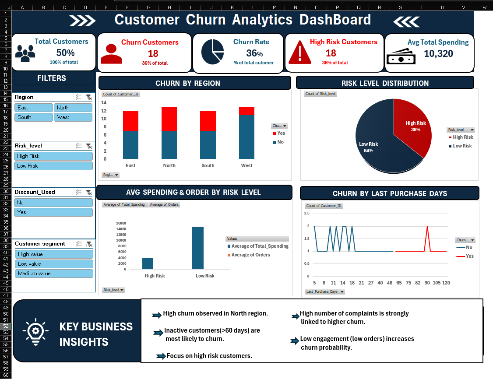

# 📊 Customer Churn Analysis Dashboard (Excel)

An interactive Excel dashboard to analyze customer churn patterns, identify high-risk customers, and generate actionable business insights to improve customer retention.

## 📸 Dashboard Preview



## 📌 Problem Statement

Customer churn is a major challenge for businesses, as losing customers directly impacts revenue and long-term growth.

This project analyzes customer behavior to identify churn patterns, evaluate customer risk levels, and understand the factors that may contribute to customer churn.

## 🎯 Project Objectives

- Identify customers who are more likely to churn.
- Analyze factors influencing customer churn.
- Identify high-risk customer segments.
- Understand customer engagement and purchasing behavior.
- Provide actionable recommendations to improve customer retention.

## 🛠️ Tools & Technologies

- Microsoft Excel
- Pivot Tables
- Excel Formulas
- Slicers
- Data Visualization
- Conditional Formatting

## 🔄 Project Workflow

### 1. Data Cleaning & Preparation
- Organized and prepared the dataset.
- Checked data consistency.
- Prepared data for further analysis.

### 2. Feature Engineering
- Created a Churn Score.
- Classified customers into different Risk Levels.
- Used customer activity, order frequency, complaints, and spending behavior.

### 3. KPI Development
- Churn Rate
- High-Risk Customers
- Customer Distribution
- Customer Engagement Metrics

### 4. Dashboard Development
- Created interactive Pivot Tables.
- Designed charts and visualizations.
- Integrated slicers for dynamic filtering.
- Built an interactive Excel dashboard.

## 📈 Key Insights

- Customers inactive for more than 60 days show higher churn risk.
- Customers with more complaints have increased churn probability.
- Low customer engagement is associated with higher churn risk.
- Discounts alone do not appear to significantly reduce customer churn risk.

## 💡 Business Recommendations

- **Target High-Risk Customers:** Provide personalized retention offers to customers with high churn scores.
- **Improve Customer Service:** Resolve complaints quickly to improve customer satisfaction.
- **Increase Customer Engagement:** Launch targeted campaigns to reconnect with inactive customers.
- **Optimize Retention Strategies:** Focus on customer behavior instead of relying only on discounts.

## 📂 Project Structure

```text
customer_churn_dashboard_excel/
│
├── Dashboard/
│   ├── Dashboard.png
│   └── data.png
│
├── customer-churn-dashboard-excel/
│
├── project_summary.md
│
└── README.md
```

## 🚀 Skills Demonstrated

- Data Cleaning and Preparation
- Feature Engineering
- Excel Formulas
- Pivot Table Analysis
- KPI Development
- Interactive Dashboard Design
- Business Insights
- Data-Driven Decision Making

## 👩‍💻 Author

**Mamta Yadav**

B.Sc. Data Science Student | Aspiring Data Analyst

- GitHub: [Mamtayadav20](https://github.com/Mamtayadav20)
